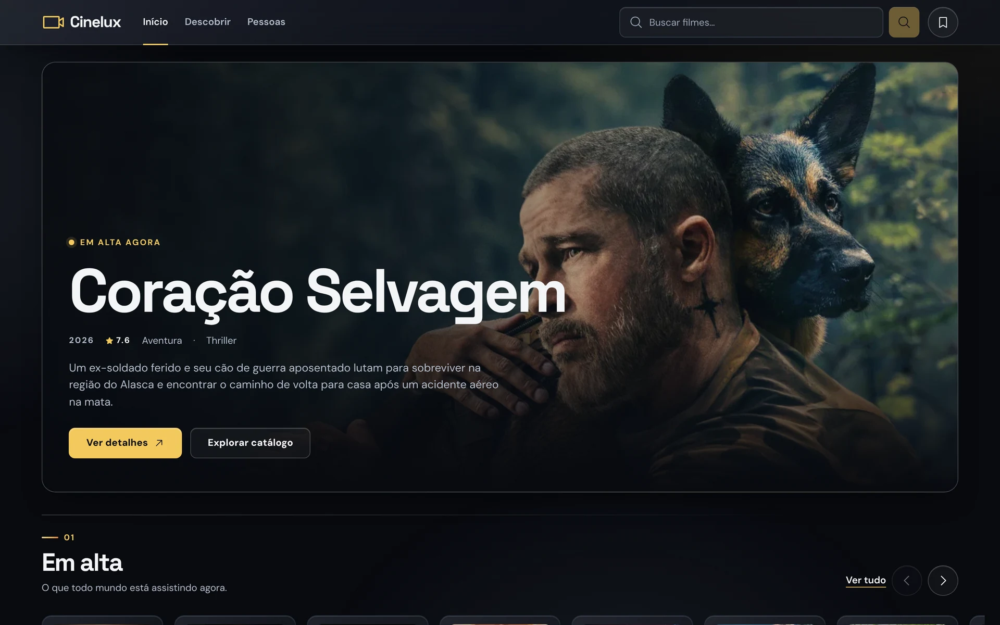
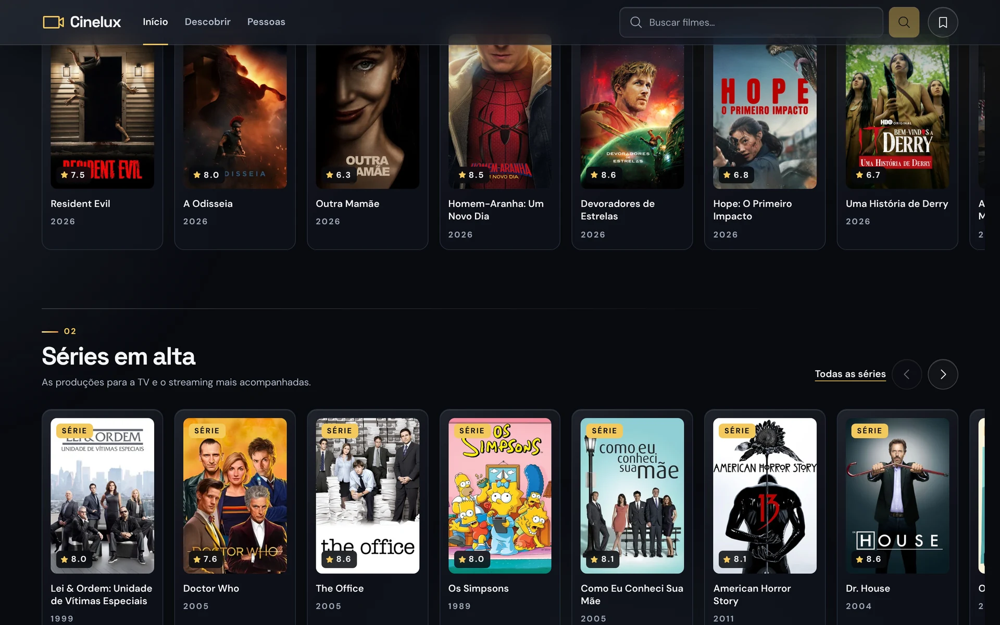
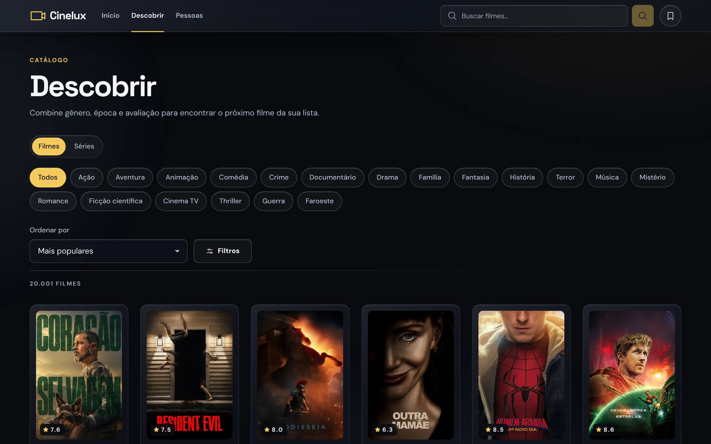
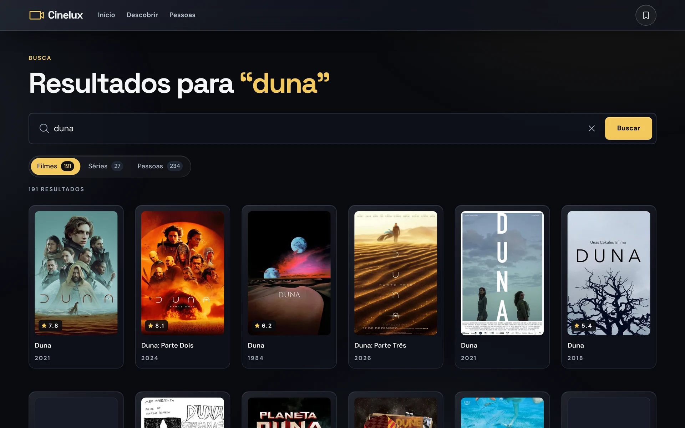
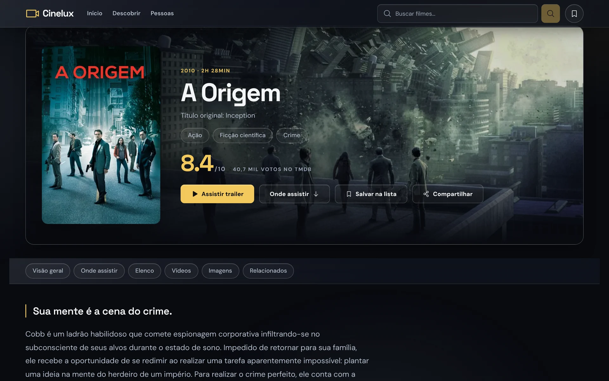
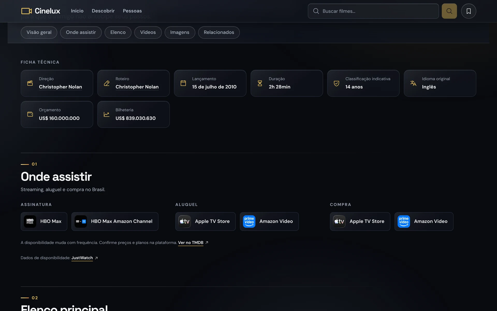
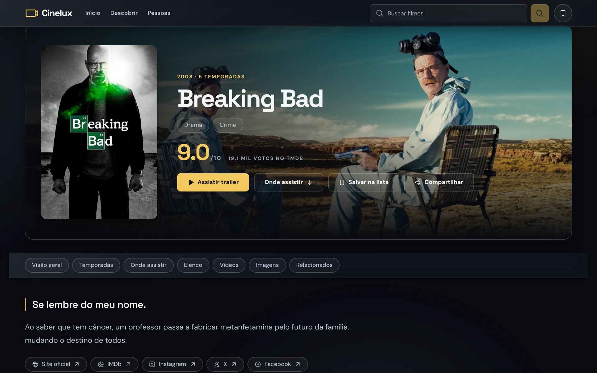
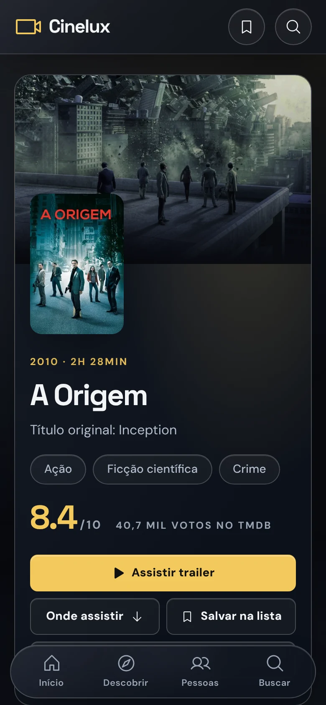

<h1 align="center">Cinelux</h1>

<p align="center">
  Acervo de cinema para encontrar um filme ou série, entender do que se trata e decidir se vale assistir.<br>
  React 19 + TypeScript + Vite, com dados do <a href="https://www.themoviedb.org/">TMDB</a> por meio de um proxy serverless.
</p>

<div align="center">

[](https://cinelux.gcruz.dev.br)
[](https://github.com/https-shini/movies_lib/actions/workflows/quality.yml)
[](LICENSE)

</div>



<p align="center">
  <a href="https://cinelux.gcruz.dev.br"><strong>Acessar a aplicação</strong></a> ·
  <a href="docs/MODEL.md">Documentação técnica</a> ·
  <a href="docs/DECISIONS.md">Decisões técnicas</a> ·
  <a href="docs/ROADMAP.md">Roadmap</a>
</p>

---

## Sumário

- [Sobre o projeto](#sobre-o-projeto)
- [Problema e proposta](#problema-e-proposta)
- [Funcionalidades](#funcionalidades)
- [Capturas de tela](#capturas-de-tela)
- [Tecnologias](#tecnologias)
- [Arquitetura](#arquitetura)
- [Pré-requisitos](#pré-requisitos)
- [Instalação e configuração](#instalação-e-configuração)
- [Variáveis de ambiente](#variáveis-de-ambiente)
- [Execução local](#execução-local)
- [Testes e qualidade](#testes-e-qualidade)
- [Build e deploy](#build-e-deploy)
- [Exemplos de uso](#exemplos-de-uso)
- [Desempenho](#desempenho)
- [Documentação complementar](#documentação-complementar)
- [Créditos](#créditos)
- [Licença](#licença)

## Sobre o projeto

O Cinelux é um catálogo de filmes, séries e pessoas do cinema com páginas completas de cada título: sinopse, nota, ficha técnica com a classificação indicativa do Brasil, trailer, onde assistir no Brasil, elenco, galerias, coleção e recomendações. Os dados e as imagens vêm da API do The Movie Database (TMDB).

O projeto nasceu como MoviesLib e foi refeito como Cinelux em fases registradas em [docs/DECISIONS.md](docs/DECISIONS.md). O repositório e o projeto na Vercel ainda usam o nome antigo (`movies_lib` e `movies-lib`).

## Problema e proposta

Decidir o que assistir exige juntar informações espalhadas — sinopse, avaliação, classificação indicativa, elenco e em qual serviço o título está disponível. O Cinelux reúne tudo em uma interface em português, rápida e acessível, sem expor a chave da API: o navegador consulta apenas o proxy `/api/tmdb`, que aceita uma lista fechada de endpoints e injeta a chave no servidor.

## Funcionalidades

- **Início** — filme em destaque, faixas "Em alta", "Séries em alta" e "Nos cinemas", ranking dos 10 mais bem avaliados, pessoas em destaque e índice de gêneros.
- **Descobrir** — filmes ou séries por gênero, ordenação, ano e nota mínima, com filtros ativos em chips removíveis e tudo registrado na URL.
- **Busca** — resultados separados em filmes, séries e pessoas, com contagem, paginação e sugestões.
- **Página do filme** — sinopse, nota, ficha técnica com classificação indicativa do Brasil, trailer em modo de privacidade aprimorada, onde assistir no Brasil (JustWatch), elenco, galerias, links oficiais, coleção e recomendações.
- **Séries, temporadas e pessoas** — criação, emissora e temporadas; episódios com sinopse, duração e nota; biografia, filmografia por área e perfis oficiais.
- **Minha lista** — filmes e séries salvos para ver depois, guardados apenas no navegador, sem cadastro.
- Coleções (franquias em ordem de lançamento) e botão de compartilhar em filmes, séries e pessoas.
- Superfícies de vidro sobre a paleta grafite e dourado, com versão opaca para quem reduz a transparência no sistema.
- Estados de carregamento, vazio e erro em português, com "Tentar novamente", página 404 e tela de erro de rota.
- Acessibilidade e responsividade: link para pular ao conteúdo, foco visível, `prefers-reduced-motion`, barra inferior no celular e nenhuma rolagem horizontal de 320 a 1440 px.

## Capturas de tela

| Faixas da página inicial | Descobrir |
| :-: | :-: |
|  |  |
| **Busca** | **Filme** |
|  |  |
| **Ficha técnica e onde assistir** | **Série** |
|  |  |
| **Pessoa** | **Celular** |
|  |  |

> Capturas da aplicação publicada. Os títulos em destaque mudam conforme a popularidade no TMDB.

## Tecnologias

- **React 19** — interface com React Router 8 (*data router*) e react-icons.
- **TypeScript 6** — modo `strict` em todo o código, sem `.js` ou `.jsx` no app.
- **Vite 8** — desenvolvimento, build e proxy local do TMDB.
- **Vitest 5** — testes unitários e de hooks com jsdom e **Testing Library**.
- **Playwright** — testes de interface (E2E) em sete tamanhos de tela e regressão visual.
- **ESLint 10** — com `typescript-eslint`, React Hooks e `jsx-a11y-x`.
- **Prettier** — formatação.
- **Vercel** — site estático e função serverless `/api/tmdb`.
- **Vercel Web Analytics** — métricas de visita sem cookies, junto com **Speed Insights**.
- **TMDB API v3** — dados e imagens, com disponibilidade de streaming do JustWatch.
- **GitHub Actions** — jobs `quality` e `e2e`, com **Dependabot** semanal.

## Arquitetura

O navegador nunca fala diretamente com o TMDB. Todas as consultas passam por `src/services/tmdb.ts`, que chama `/api/tmdb/<endpoint>`; em produção, esse caminho é atendido pela função `api/tmdb.ts` e, no desenvolvimento, pelo mesmo proxy embutido no Vite.

```text
Navegador                               Vercel                               TMDB
┌──────────────────────────┐   GET    ┌──────────────────────────────┐   GET   ┌─────────┐
│ pages/ → hooks/ →        │ ───────► │ api/tmdb.ts (server/tmdbProxy)│ ──────► │ API v3  │
│ services/tmdb.ts         │ /api/tmdb│ • só GET e endpoints da lista │ + chave └─────────┘
│ (cache de 5 min)         │ ◄─────── │ • descarta api_key do cliente │
└──────────────────────────┘          │ • tempo limite de 8 s         │
                                      │ • cache na CDN por tipo       │
                                      └──────────────────────────────┘
```

O proxy guarda respostas de sucesso no cache da Vercel (gêneros 24 h, listas 1 h, detalhes 6 h, busca 10 min) e nunca guarda erros. Todas as respostas levam cabeçalhos de segurança definidos no `vercel.json`, incluindo uma Content-Security-Policy em modo de bloqueio; o `vite preview` usa os mesmos valores.

<details>
<summary><strong>Estrutura de diretórios</strong></summary>

```text
api/tmdb.ts                 função serverless da Vercel (/api/tmdb)
server/
├── tmdbProxy.ts            lista de permissões, chave, tempo limite e cache
├── viteTmdbProxy.ts        o mesmo proxy em npm run dev e npm run preview
└── securityHeaders.ts      cabeçalhos aplicados pelo preview
src/
├── main.tsx                rotas (createBrowserRouter) e estilos globais
├── App.tsx                 layout: cabeçalho, conteúdo, rodapé e barra inferior
├── services/tmdb.ts        única porta de saída para a API
├── hooks/                  useMovies, useMovie, useTv, useSeason, usePerson,
│                           usePeople, useCollection, useWatchlist, useGenres…
├── lib/                    regras puras: formatação, imagens, descoberta,
│                           paginação, provedores, lista, coleções…
├── components/
│   ├── layout/             cabeçalho, barra inferior, rodapé e marca
│   ├── movie/              pôsteres, faixas, ranking, destaque, trailer e streaming
│   ├── title/              cabeçalho do título, ficha, elenco, galerias, temporadas
│   ├── person/             cartões, grade e links de pessoas
│   └── ui/                 diálogo, faixa, paginação, nota e estados
├── pages/                  Home, Discover, Search, Movie, Tv, Season, Person,
│                           People, Collection, Watchlist, About, Privacy, NotFound
├── types/ · i18n/ · styles/
└── test/                   utilitários dos testes unitários
e2e/                        fixtures do TMDB, helpers e testes de interface
docs/                       decisões, roadmap, identidade visual e documentação técnica
```

</details>

## Pré-requisitos

- **Node.js 24** ou superior e **npm 10** ou superior.
- Uma chave da API do TMDB (chave v3 ou token de leitura v4), obtida em [themoviedb.org/settings/api](https://www.themoviedb.org/settings/api).

## Instalação e configuração

```bash
git clone https://github.com/https-shini/movies_lib.git
```

```bash
cd movies_lib
```

```bash
npm ci
```

```bash
cp .env.example .env
```

## Variáveis de ambiente

| Variável | Obrigatória | Descrição |
| --- | :-: | --- |
| `TMDB_API_KEY` | Sim | Chave v3 ou token de leitura v4 do TMDB. Lida apenas no servidor (`/api/tmdb`) |

```dotenv
TMDB_API_KEY=YOUR_TMDB_API_KEY
```

Não use o prefixo `VITE_` para segredos — variáveis com esse prefixo entram no código enviado ao navegador — e não versione o `.env`.

## Execução local

```bash
npm run dev
```

O servidor de desenvolvimento do Vite atende o app e o proxy `/api/tmdb` com a chave do `.env`.

| Comando | O que faz |
| --- | --- |
| `npm run dev` | Servidor de desenvolvimento com o proxy |
| `npm run build` | Build de produção em `dist/` |
| `npm run preview` | Serve o build localmente, com o proxy e os cabeçalhos de produção |
| `npm run lint` | ESLint sem avisos tolerados |
| `npm run typecheck` | Verificação de tipos do app e da configuração |
| `npm test` | Testes unitários e de hooks (Vitest) |
| `npm run test:e2e` | Testes de interface (Playwright) |
| `npm run test:visual` | Regressão visual contra uma referência |
| `npm run format:check` | Confere a formatação |
| `npm run check` | Lint, tipos, testes e build |

## Testes e qualidade

```bash
npm test
```

Na última verificação: **341 testes unitários em 33 arquivos, todos aprovados**, e verificação de tipos sem erros.

Os testes de interface usam o Playwright com o Chromium contra o build servido pelo `vite preview` — nunca contra a produção — e não dependem do TMDB:

- as respostas de `/api/tmdb` vêm de fixtures JSON tipadas em `e2e/fixtures/` (se uma fixture sair do modelo, o `typecheck` falha);
- imagens do TMDB, o player do YouTube e os scripts da Vercel são substituídos localmente; o teste falha se o app pedir outro domínio, registrar erro no console ou violar a CSP;
- cada teste roda em sete larguras (`mobile-320` a `desktop-1440`), e o projeto `proxy` testa o proxy por HTTP.

```bash
npx playwright install --with-deps chromium
```

```bash
npm run test:e2e
```

A CI (`.github/workflows/quality.yml`, Node 24) roda em todo pull request e push na `main`: o job `quality` faz instalação limpa, `npm audit`, formatação, lint, tipos, testes e build; o job `e2e` roda o Playwright na imagem oficial `mcr.microsoft.com/playwright`.

## Build e deploy

```bash
npm run build
```

Para publicar na Vercel:

1. Em **Settings → Environment Variables**, cadastre `TMDB_API_KEY` como *Secret* em **Production** e **Preview**.
2. Faça um novo deploy para que a função passe a usar a chave.
3. Ative **Web Analytics** e **Speed Insights** no painel do projeto.

O `vercel.json` encaminha `/api/tmdb/*` para a função e as demais rotas para `index.html`, o que permite abrir diretamente endereços como `/movie/550` ou `/discover?genre=18`.

## Exemplos de uso

| Objetivo | Endereço |
| --- | --- |
| Abrir um filme | `/movie/27205` |
| Abrir uma série | `/serie/1396` |
| Ver uma temporada | `/serie/1396/temporada/1` |
| Ver uma pessoa | `/pessoa/6193` |
| Buscar | `/search?q=duna` |
| Descobrir dramas | `/discover?genre=18` |
| Descobrir séries | `/discover?tipo=series` |
| Ver uma coleção | `/colecao/2344` |
| Minha lista | `/minha-lista` |

Consulta direta ao proxy (endpoints permitidos em `server/tmdbProxy.ts`):

```bash
curl "https://cinelux.gcruz.dev.br/api/tmdb/movie/27205?language=pt-BR"
```

## Desempenho

- Fontes servidas pelo próprio site (`src/assets/fonts`, licenças OFL junto aos arquivos).
- Imagens responsivas com `srcset` e `sizes` medidos para pôsteres e fundos.
- A página de filme faz uma única requisição; respostas bem-sucedidas ficam em cache no navegador por 5 minutos; cada rota pré-carrega seus dados enquanto o código da página é baixado.
- Páginas além do Início carregadas sob demanda (divisão por rota).

Medições em [docs/MODEL.md](docs/MODEL.md) e [docs/DECISIONS.md](docs/DECISIONS.md) (D-40 e D-41).

## Documentação complementar

- [Documentação técnica](docs/MODEL.md)
- [Decisões técnicas](docs/DECISIONS.md)
- [Roadmap](docs/ROADMAP.md)
- [Identidade visual do Cinelux](docs/Cinelux_Identidade_Visual.md)
- [Como contribuir](docs/CONTRIBUTING.md)

## Créditos

Dados e imagens fornecidos pelo [TMDB](https://www.themoviedb.org/). Este produto usa o TMDB e as APIs do TMDB, mas não é endossado, certificado nem aprovado pelo TMDB. Disponibilidade de streaming fornecida pelo [JustWatch](https://www.justwatch.com/).

## Licença

Distribuído sob a licença MIT. Consulte o arquivo [LICENSE](LICENSE).

Desenvolvido por [Guilherme Cruz](https://gcruz.dev.br).
