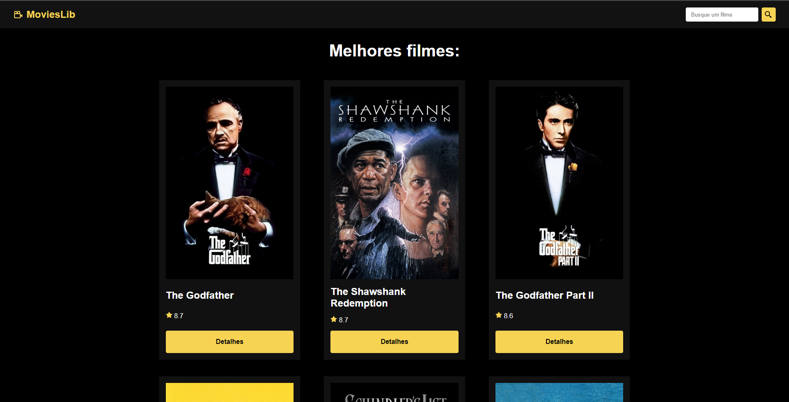
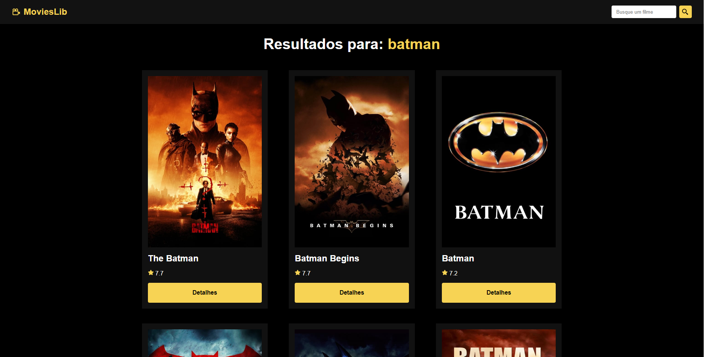
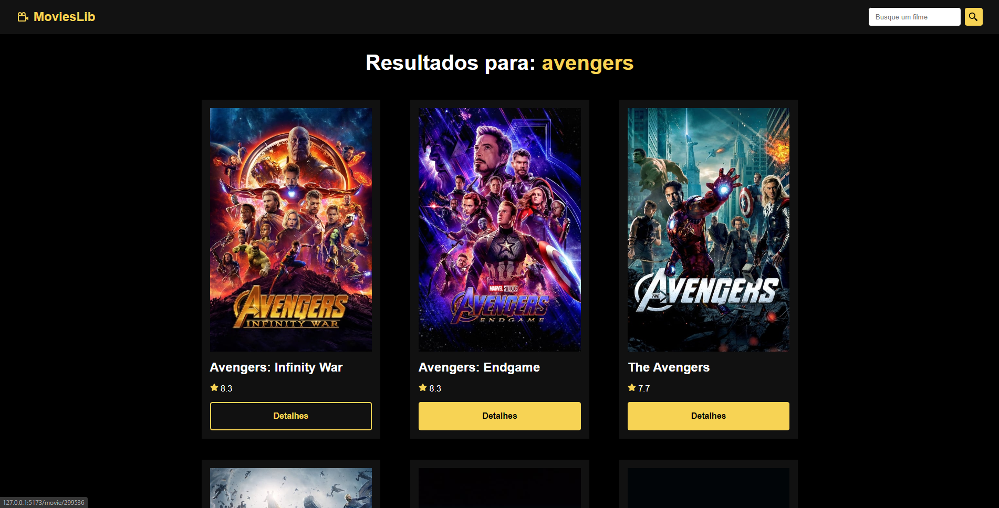
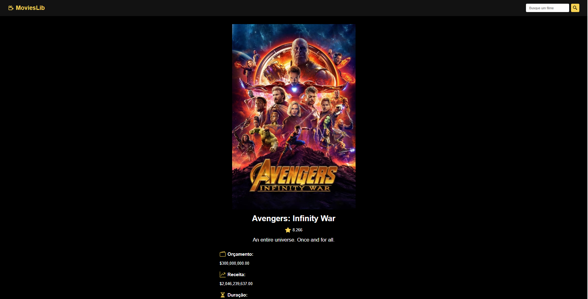

# MoviesLib

Aplicação web para descobrir e pesquisar filmes, consultar informações e explorar títulos usando a API do [The Movie Database (TMDB)](https://www.themoviedb.org/).

**Aplicação publicada:** https://movieslib-krd.vercel.app

## Visão geral

O MoviesLib começou como um projeto de exploração de filmes com React e TMDB. A modernização está sendo feita incrementalmente, preservando as funcionalidades existentes e preparando a aplicação para evoluir para uma plataforma de catálogo, descoberta e acompanhamento de filmes.

## Funcionalidades atuais

- Página inicial com seções de filmes em alta, mais bem avaliados e em cartaz.
- Pesquisa de filmes por título, com resultados em português e paginação.
- Descoberta de filmes com filtros por gênero, ano, nota mínima e ordenação. Os filtros só são aplicados ao enviar o formulário e ficam registrados na URL.
- Paginação dos resultados do catálogo e da busca.
- Página de detalhes com título original, sinopse, orçamento, bilheteria, duração, elenco, trailer (priorizando versões oficiais em português) e recomendações, com filmes semelhantes como alternativa.
- Disponibilidade de streaming, aluguel e compra no Brasil, agrupada por modalidade.
- Estados de carregamento, erro e resultados vazios, com mensagens de erro em português.
- Navegação com React Router (modo data router), restauração de rolagem, título da aba por página, página 404 e tela de erro para falhas inesperadas.
- Acessibilidade: link para pular ao conteúdo, foco visível, rótulos descritivos e suporte a `prefers-reduced-motion`.
- Interface responsiva para desktop e dispositivos móveis.

## Tecnologias

- React 18
- Vite 8
- Vitest 5
- ESLint 10 com regras para React Hooks
- React Router 7
- JavaScript (ES Modules)
- CSS
- TMDB API

## Requisitos

- Node.js 24 ou superior.
- npm 10 ou superior.
- Chave de API do TMDB.

## Configuração local

1. Clone o repositório.
2. Instale as dependências:

   ```bash
   npm ci
   ```

3. Crie seu arquivo de ambiente a partir do modelo:

   ```bash
   cp .env.example .env
   ```

   No Windows PowerShell:

   ```powershell
   Copy-Item .env.example .env
   ```

4. Edite o arquivo `.env` e informe sua chave do TMDB em `TMDB_API_KEY` (chave da API v3 ou token de leitura v4). Ela é usada apenas pelo servidor local do Vite, que atende `/api/tmdb` em `npm run dev` e `npm run preview`.
5. Inicie o servidor local:

   ```bash
   npm run dev
   ```

## Verificações

Execute a análise estática do código:

```bash
npm run lint
```

Verifique vulnerabilidades conhecidas nas dependências:

```bash
npm audit
```

Execute os testes unitários:

```bash
npm test
```

Execute os testes em modo de observação:

```bash
npm run test:watch
```

Execute a verificação completa, incluindo lint, testes e build:

```bash
npm run check
```

Para gerar e visualizar a versão de produção:

```bash
npm run build
npm run preview
```

O GitHub Actions executa instalação limpa, auditoria de dependências, ESLint, testes unitários e build nos pushes e pull requests.

## Implantação

Na Vercel, a pasta `api/` é publicada como função serverless (`/api/tmdb`) e o restante como site estático.

1. Em **Settings → Environment Variables**, cadastre `TMDB_API_KEY` com o tipo **Secret**, nos ambientes **Production** e **Preview**.
2. Faça um novo deploy para que a função passe a usar a chave.

O arquivo `vercel.json` redireciona as demais rotas para `index.html`, permitindo abrir diretamente endereços como `/movie/550` ou `/discover?genre=18`. As respostas do proxy são armazenadas em cache na CDN da Vercel (`s-maxage`), reduzindo chamadas ao TMDB.

## Estrutura atual

```text
api/
└── tmdb.js                 # função serverless da Vercel (/api/tmdb)

server/
├── tmdbProxy.js            # validação, chave e cache do proxy do TMDB
└── viteTmdbProxy.js        # /api/tmdb no servidor local do Vite

src/
├── components/
│   ├── AsyncState.jsx
│   ├── MovieCard.jsx
│   ├── MovieSection.jsx
│   ├── Navbar.jsx
│   ├── Pagination.jsx
│   └── WatchProviders.jsx
├── hooks/
│   ├── useAsyncData.js
│   └── useDocumentTitle.js
├── pages/
│   ├── Discover.jsx
│   ├── Home.jsx
│   ├── Movie.jsx
│   ├── NotFound.jsx
│   ├── RouteError.jsx
│   └── Search.jsx
├── services/
│   ├── discover.js
│   ├── movieDetails.js
│   ├── pagination.js
│   ├── search.js
│   ├── tmdb.js
│   ├── tmdbErrors.js
│   ├── tmdbUrl.js
│   └── watchProviders.js
├── utils/
│   └── formatters.js
├── App.jsx
├── index.css
└── main.jsx

tests/
├── discover.test.js
├── formatters.test.js
├── movieDetails.test.js
├── pagination.test.js
├── tmdb.test.js
├── tmdbProxy.test.js
├── tmdbUrl.test.js
└── watchProviders.test.js
```

Os arquivos `.css` ficam ao lado do componente ou da página que estilizam.

## Prévia do projeto original

As imagens abaixo registram a versão anterior do MoviesLib e serão atualizadas conforme a reformulação visual avançar.

<div align="center">
  
  
  
  
</div>

## Segurança

O navegador nunca recebe a chave do TMDB. Todas as consultas passam pelo proxy `/api/tmdb` (`server/tmdbProxy.js`), que:

- lê `TMDB_API_KEY` apenas no servidor;
- aceita somente `GET` e os endpoints usados pela aplicação (lista de permissões);
- descarta parâmetros desconhecidos, inclusive tentativas de enviar outra `api_key`;
- define cache na CDN para respostas bem-sucedidas.

Não use o prefixo `VITE_` para segredos: variáveis com esse prefixo são incorporadas ao código enviado ao navegador.

Não envie seu arquivo `.env` ao Git.

## Documentação e contribuição

- [Documentação técnica](./read-model/MODEL.md)
- [Como contribuir](./read-model/CONTRIBUTING.md)

## Roadmap

- Atualizar a cadeia de ferramentas e dependências.
- Ampliar a análise estática e a cobertura de testes.
- Implementar descoberta avançada, filtros, gêneros e paginação.
- Integrar disponibilidade regional de streaming, aluguel e compra.
- Evoluir o backend para persistência e autenticação.
- Adicionar perfis, avaliações, comentários, listas e recursos sociais.

## Créditos

Dados e imagens de filmes fornecidos pelo [TMDB](https://www.themoviedb.org/). Este projeto não é endossado nem certificado pelo TMDB.

## Licença

Este projeto está sob a [licença MIT](./LICENSE).
